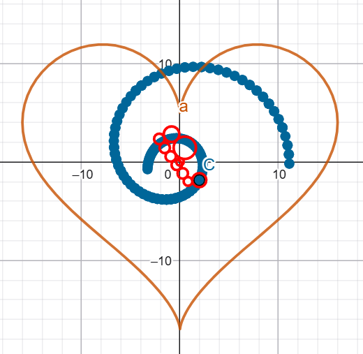

# Gear-Based Curve Approximation

An independent scientific computing project exploring the numerical approximation of parametric curves using coupled rolling gears.

The goal was to design a mechanical system capable of tracing a target curve while respecting no-slip rolling constraints, with the possibility of building a physical mechanism.

## Mathematical Approach

The algorithm was developed from scratch in Python using NumPy and includes:

- Parametric modeling of coupled rolling mechanisms.
- Numerical integration using Simpson's rule.
- Gradient estimation through central finite differences.
- Gradient descent optimization of gear radii, angular offsets, and angular velocity.
- NumPy vectorization for efficient numerical calculations.

## Results

The algorithm was tested using a heart-shaped parametric curve. Although optimization reduced the numerical error, the resulting trajectory did not accurately reproduce the target shape.

### Curve Approximation

### Error Landscape

A 3D visualization of the error function, illustrating the complexity of the optimization problem.

## Project Status

**Experimental / Work in Progress**

The implementation demonstrates the mathematical formulation and numerical optimization approach, but further improvements are needed to achieve accurate curve reproduction and validate the physical feasibility of the mechanism.

## Technologies

Python · NumPy · Matplotlib · Numerical Optimization
